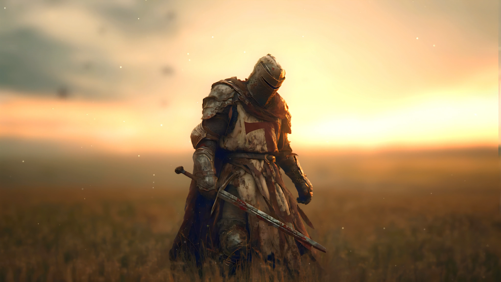

  

Hey, I'm Yared 👋

### Aspiring Web Developer | Learning by Building

I'm currently learning web development, practicing my skills, and turning creative ideas into real projects.

I enjoy experimenting with modern web design, cinematic visuals, interactive animations, and user experiences that make websites feel different.

I'm still learning, improving, and exploring what I can create with code and AI tools.

---

## What I'm Working On

- **Omo Valley** — A cinematic website exploring the people, culture, and landscapes of the Omo Valley through visual storytelling.
- **Cyber Safety Website** — An educational project about online safety, cybersecurity threats, and digital awareness.
- **Creative Web Experiments** — Practicing modern layouts, scroll-based animations, interactive effects, and responsive design.

## Technologies I'm Learning

- HTML
- CSS
- JavaScript
- Git & GitHub
- Modern web design and animation

## Open to Website Projects

I'm currently practicing, building my portfolio, and looking for opportunities to learn through real projects.

**Need a website or have a creative idea?** Feel free to reach out. I'd be happy to hear about your project, discuss your ideas, and see how I can help.

- **GitHub:** [@yaredlab](https://github.com/yaredlab)
- **Telegram:** [Message me](https://t.me/Schimchy)

---

*Learning every day. Building one project at a time.*
-->

<picture>
  <source media="(prefers-color-scheme: dark)" srcset="https://raw.githubusercontent.com/tobiasmeyhoefer/tobiasmeyhoefer/output/github-snake-dark.svg" />
  <source media="(prefers-color-scheme: light)" srcset="https://raw.githubusercontent.com/tobiasmeyhoefer/tobiasmeyhoefer/output/github-snake.svg" />
  
</picture>
